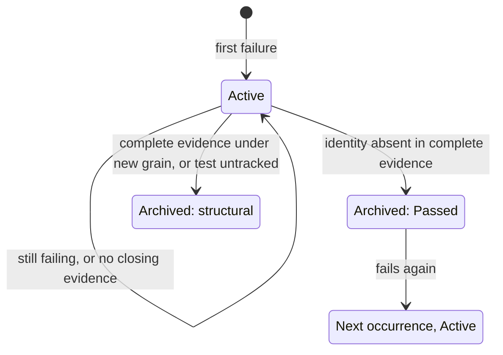

# dbt-dqm concepts

This page explains the ideas behind dbt-dqm for a dbt engineer who runs it in production and has
never needed to read its source. It uses one BigQuery example throughout. For the steps of a run,
read [How a run works](how-it-works.md). For the tables a run leaves behind, read
[Warehouse tables](warehouse-tables.md).

## The problem it solves

A dbt data test tells you how many rows failed today. It doesn't tell you which of those rows also
failed yesterday, which ones are new, which ones came back after a fix, or what someone already
decided about them. dbt-dqm keeps that memory. It turns the failed rows of the tests you choose into
issues that persist across runs, records when each issue appears, passes and recurs, and keeps the
owner, status and notes that reviewers add.

## Two packages, installed separately

dbt-dqm ships as two pieces that you install in two different ways.

| Piece | Name | Installed with | Provides |
| --- | --- | --- | --- |
| dbt package | `dbt_dqm` | `packages.yml`, Git revision `v0.2.5`, then `dbt deps` | Macros, models, the test materialization override and the warehouse schema |
| Python package | `dbt-dqm` | `pip install 'dbt-dqm[bigquery]==0.2.5'` | The `dbt-dqm` command and the local review app |

Follow the [upgrade steps](legacy.md#upgrading) when changing versions. The Python extras
(`[bigquery]`, `[postgres]`) install the warehouse client the app needs. They never install dbt:
you install dbt yourself, and `dbt-dqm` runs that dbt as a separate program.

See [supported configurations](supported-configurations.md) for supported engines, warehouses,
Python versions, and installation options.

## The running example

A singular test checks that every customer has an email:

```sql
-- tests/customers_missing_email.sql
{{ config(
    enabled=var('dqm_enabled', false),
    store_failures=true,
    limit=100,
    meta={'dbt_dqm': {
        'granularity': ['customer_id'],
        'owner': 'customer_data'
    }}
) }}

select customer_id, email, country
from {{ ref('customers') }}
where email is null
```

Say the first run returns customers `C-1` and `C-2`. The sections below follow those two rows.

## Test opt-in

A test takes part in dbt-dqm when its configuration has a `meta.dbt_dqm` key. Tags, names and
folders play no part. Before it runs anything, `dbt-dqm run` also checks that each selected test has:

- `granularity`: a non-empty, ordered list of the columns that identify a failing record.
- `store_failures=true` with table storage, because dbt-dqm reads the failed rows from that table.
- `fail_calc` of `count(*)` (dbt's default).
- A positive native `limit`. If it's missing, the run warns and uses `dbt_dqm_default_test_limit`
  (100).

`owner`, `priority`, `criticality` and `call_to_action` are optional.
[Configure tests](reference-configuration.md#tracked-data-tests) lists every key.

**Why `enabled=var('dqm_enabled', false)`?** It turns the test off in ordinary `dbt test` and
`dbt build`. dbt-dqm runs tracked tests only in its own command, which sets `dqm_enabled: true`
for its dbt calls. If a test must also keep running in your normal dbt CI, leave the original
unchanged and add a separately named copy for dbt-dqm. See the
[generic-test example](quickstart-existing-project.md#2-preserve-the-ordinary-ci-test).

### What a run stores

dbt-dqm stores **every column** the test returns, not only the granularity columns. In the example,
`customer_id`, `email` and `country` all go into the issue's `record_values_json`. The granularity
columns decide *which* issue a row belongs to. The other columns are values that can change while
the issue stays the same.

This means the test query decides what lands in the warehouse tables. Leave out columns you don't
want kept, such as personal data you don't need for review.

### The limit, and why a full limit is incomplete evidence

The native `limit` caps how many failed rows dbt keeps. dbt-dqm orders the rows by identity, then
by the whole row, before it applies the limit. Each run therefore keeps the same sample of a large
failure set.

When a test returns as many rows as its limit, dbt-dqm can't know how many more exist. It marks
that collection `limit_reached`. The rows it did see still open and update issues. An issue whose
row didn't fit under the limit is **not** treated as fixed, because its absence proves nothing. The
run prints a warning that names those tests. Raise the limit if you need complete evidence.

## Identity versus occurrence

These two ideas explain most of dbt-dqm's behaviour.

**Identity** answers "which record is this?". dbt-dqm builds it from the granularity values:

1. Each value is cast to text, trimmed and lowercased. `C-1`, `c-1` and ` C-1 ` are the same record.
2. The column names and values are joined in a length-prefixed format, so no two different inputs
   produce the same text.
3. dbt-dqm hashes the `dqm-id-v1` text with SHA-256 and stores the lowercase hexadecimal
   result as `unique_id`. The encoded names stay in grain order and nulls have their own
   marker. The row's display JSON is separate from this encoding.

The same record gets the same `unique_id` on every run and on every supported warehouse and dbt
engine. Identity belongs to one test: the same customer failing two tests gives two issues. The
hash itself uses only the granularity names and values, though, so two tests with the same grain
produce the same `unique_id` for the same customer. When you query, always pair `unique_id` with
`test_unique_id`.

Two consequences follow:

- If several failed rows share one identity (for example, a join duplicates `C-1`), they collapse
  into **one** issue. `failure_row_count` records how many rows there were. dbt-dqm keeps the row
  whose JSON sorts first as the representative.
- Because the limit applies to raw rows before this collapse, a test can reach its limit and still
  capture fewer issues than the limit.

**Occurrence** answers "which episode of this record failing is this?". An occurrence starts when a
record begins to fail and ends when a later run proves it no longer fails. If `C-1` is fixed and
later breaks again, that is the same identity but a **new** occurrence, numbered 2. Each occurrence
has its own `occurrence_id`. Reviewer edits belong to an occurrence, so a recurrence starts with a
clean review, and the earlier review is shown next to it as context.

There are a few more terms in the [glossary](#glossary). An **observation** is one record seen
failing in one run. An **event** is one change in an occurrence's lifecycle.

## The issue lifecycle

Each occurrence has a package-managed lifecycle (`record_status` and `close_reason`). Reviewer
state is a separate dimension, described in the next section.



| Transition | Event | Close reason |
| --- | --- | --- |
| First failure | `APPEARED` | |
| Still failing (in complete or capped evidence) | `VALUES_CHANGED` if values differ, otherwise none | |
| No closing evidence: identity omitted from a capped run, or no usable execution | none | |
| Identity absent in complete evidence | `DISAPPEARED` | `Passed` |
| Identity absent in complete evidence under a new grain | `CLOSED_STRUCTURAL` | `IDENTITY_CHANGED` |
| Test no longer tracked | `CLOSED_STRUCTURAL` | `TEST_REMOVED` |
| Fails again after `Passed` | `REAPPEARED` | |

The rules behind the diagram:

- **Opening.** The first run where a record fails creates occurrence 1 with status `Active` and an
  `APPEARED` event.
- **Still failing.** A later failing run keeps the same occurrence. If any non-granularity value
  changed, it emits `VALUES_CHANGED`. Reordering the same columns isn't a change. A
  `STILL_FAILING` event is written only if you set `dbt_dqm_emit_still_failing_events: true`.
- **Closing as passed.** An issue closes when its identity is absent from a complete, conclusive
  execution of its test. The test itself can still fail on other records. In the example, if a
  later run returns only `C-2`, the `C-1` occurrence is archived with `close_reason = 'Passed'` and
  a `DISAPPEARED` event, while `C-2` stays open.
- **Capped evidence.** An execution that reached its limit still opens issues for the identities
  it saw, keeps them open and can emit `VALUES_CHANGED`. It never closes an identity it didn't
  return, because that identity may simply not have fit under the limit.
- **No usable evidence.** An execution that errored, was skipped, or had a configuration or
  collection error changes nothing. A run that doesn't execute the test adds no new evidence for it
  (see [the note on selection](#a-rename-is-a-removal)).
- **Structural closure, grain change.** If you change a test's granularity, the old identities no
  longer exist under the new grain. They close as `IDENTITY_CHANGED` on the first complete,
  conclusive execution under the new grain, and rows under the new grain open new occurrences. A
  capped execution doesn't close them, for the same reason as above.
- **Structural closure, test removed.** If a test is no longer tracked (see below), its open issues
  close as `TEST_REMOVED` on the next reconciliation, without any new execution. Both structural
  closures emit `CLOSED_STRUCTURAL`.
- **Recurrence.** If an occurrence closed as `Passed` and its record fails again, dbt-dqm opens the
  next occurrence and emits `REAPPEARED`. After a structural closure, a new failure counts as
  `APPEARED`, not as a recurrence.

### A rename is a removal

dbt identifies a test by its node `unique_id`, which includes its name. Renaming a test, moving it
to another package, disabling it, or deleting its `meta.dbt_dqm` key closes its open issues as
`TEST_REMOVED` on the next run. The renamed test then opens fresh issues.

Running a subset with `--select` or `--exclude` is different. Selection decides which tests
**execute** in this run. A tracked test you didn't select gets no new execution, but it stays
tracked, so it is never closed as removed. Reconciliation can still apply evidence that an earlier
run captured for it and never processed, for example after a reconciliation that failed.
[How a run works](how-it-works.md#reconcile-turn-evidence-into-occurrences) explains why.

## Review state

Reviewers change six fields in the app: `workflow_status`, `review_verdict`, `dqm_owner`, `notes`,
`ticket_url` and `call_to_action`.

- `workflow_status`: `NEW`, `TRIAGED`, `IN_PROGRESS`, `BLOCKED`, `RESOLVED`, `ACCEPTED_RISK` or
  `FALSE_POSITIVE`.
- `review_verdict`: `UNREVIEWED`, `TRUE_POSITIVE` or `FALSE_POSITIVE`, independent of the workflow.

**Setting `RESOLVED` doesn't close the issue.** The lifecycle follows the data only. An occurrence
marked `RESOLVED` stays `Active` until a complete run no longer returns its record. When it closes,
dbt-dqm copies the workflow value into `workflow_status_at_close`. If the record later fails
again, the new occurrence is flagged `is_potential_regression`, which means "this came back after
someone marked it resolved".

Runs never overwrite reviewer fields. A new occurrence starts with workflow `NEW`, verdict
`UNREVIEWED`, empty notes and ticket, and an owner and call to action taken from the test.
[How a run works](how-it-works.md#what-carries-over-between-runs) shows what carries over in each
case.

### Ownership

The initial owner of a new occurrence comes from, in order:

1. A `dqm_owner` column in the failed row, if the test returns one.
2. `meta.dbt_dqm.owner`.
3. `meta.owner`.
4. Otherwise, unassigned.

If two failed rows for the same identity name different row owners, dbt-dqm falls back to the test
owner and counts the conflict. After that, the owner is a reviewer field like the others.

## Glossary

| Term | Meaning |
| --- | --- |
| Tracked test | A dbt data test whose `meta` has a `dbt_dqm` key. |
| Granularity (grain) | The ordered list of columns in `meta.dbt_dqm.granularity` that identify a failing record. |
| Identity scheme | The granularity column names, in a canonical form (`identity_scheme_signature`). Changing the granularity changes the scheme. |
| Identity (`unique_id`) | SHA-256 of the normalized granularity values. The same record always gets the same identity within one test. |
| Observation | One identity seen failing in one test execution. Duplicate rows collapse into one observation. |
| Execution | One tracked test run in one dbt invocation, with its collection outcome. |
| Collection status | How capture went: `success`, `not_applicable` (no failures), `limit_reached`, `configuration_error`, `inconclusive` or `collection_error`. |
| Occurrence | One continuous failing episode of one identity. A recurrence is a new occurrence with the next `occurrence_number`. |
| Active, Archived | Package-managed lifecycle states of an occurrence (`record_status`). |
| Close reason | Why an occurrence was archived: `Passed`, `IDENTITY_CHANGED` or `TEST_REMOVED`. |
| Event | One lifecycle change, such as `APPEARED`, `VALUES_CHANGED`, `DISAPPEARED`, `REAPPEARED`, `CLOSED_STRUCTURAL` or `EVIDENCE_SKIPPED`. |
| Recurrence | A new occurrence whose previous occurrence closed as `Passed` (`is_recurrence`). |
| Potential regression | A recurrence whose previous occurrence was `RESOLVED` when it closed (`is_potential_regression`). |
| Annotation | A reviewer field on an occurrence. Each applied change increases `annotation_version` and is written to `dqm_annotation_changes`. |
| Reconciliation | The step that turns new evidence into occurrence and event changes. It runs inside the `dqm_reconcile` model. |
| Generation | A counter that every reconciliation, migration and recovery operation increases, so readers can tell whether the state changed under them. |
| Installation | One set of dbt-dqm tables in one schema, marked `dqm-full-v1` and identified by an `installation_id`. |
| Workspace | The app's local SQLite file with the synced issues and your unapplied edits. |
